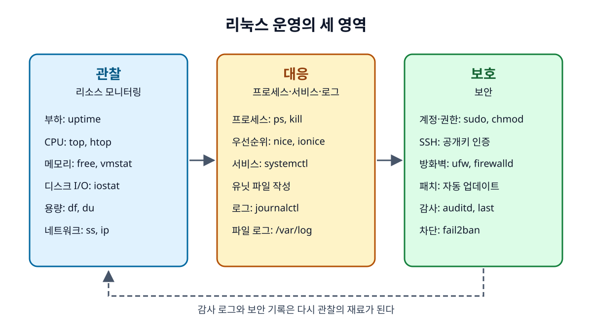
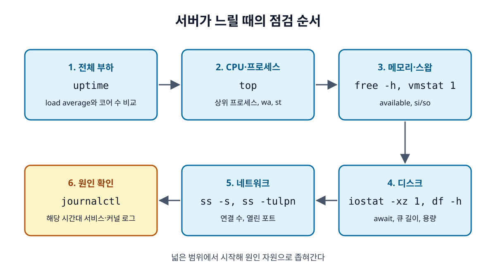
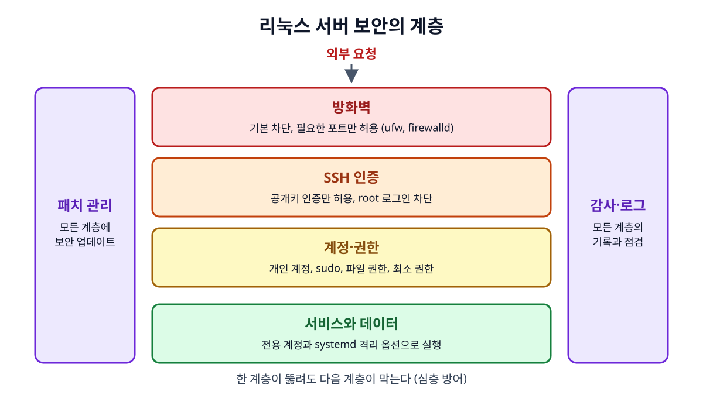

## 개요

리눅스의 구조와 배포판을 다룬 이전 글에 이어, 이 글은 실제로 서버를 **운영**할 때 필요한 내용을 다룬다. 운영 작업은 크게 세 영역으로 나눌 수 있다.

- **관찰(모니터링)**: CPU, 메모리, 디스크, 네트워크가 지금 어떤 상태인지 확인한다.
- **대응(프로세스·서비스·로그 관리)**: 문제가 되는 프로세스나 서비스를 제어하고, 로그에서 원인을 찾는다.
- **보호(보안)**: 계정과 권한, SSH 접속, 방화벽, 패치, 감사 로그로 시스템을 지킨다.

세 영역은 따로 떨어져 있지 않다. 모니터링에서 이상 징후를 발견하면 로그와 서비스 관리로 원인을 좁히고, 보안 설정에서 남긴 감사 로그는 다시 관찰의 재료가 된다. 그림 1처럼 각 영역에서 주로 쓰는 도구를 묶어 두면 상황별로 어떤 명령을 꺼내야 하는지 정리하기 쉽다.


*그림 1. 리눅스 운영의 세 영역과 대표 도구*

이 글의 예시는 systemd를 쓰는 최신 배포판(Ubuntu 24.04, RHEL 9 계열)을 기준으로 한다. 계열에 따라 패키지 이름이나 로그 파일 경로가 다른 부분은 따로 표시한다.

## 리소스 모니터링

### 부하 한눈에 보기: uptime과 load average

가장 먼저 확인할 값은 **load average**다. `uptime`, `top`, `w` 명령 모두 첫 줄에 이 값을 보여준다.

```bash
uptime
```

```text
 14:05:31 up 12 days,  3:41,  2 users,  load average: 0.52, 0.61, 0.58
```

세 숫자는 각각 최근 1분, 5분, 15분 동안의 평균 부하다. 리눅스의 load average는 **CPU에서 실행 중이거나 실행을 기다리는 프로세스**와 **디스크 I/O 등을 기다리며 중단 불가능한 대기(D 상태)에 있는 프로세스**의 수를 함께 센다. 그래서 CPU 사용률은 낮은데 load average만 높다면 디스크나 네트워크 스토리지의 지연을 의심해볼 수 있다.

load average는 CPU 코어 수와 비교해서 읽는다. 코어가 4개인 서버에서 값이 4 근처라면 코어가 대체로 꽉 차 있다는 뜻이고, 이를 계속 크게 넘으면 처리 대기가 쌓이고 있다는 뜻이다. 코어 수는 `nproc`으로 확인한다. 세 값을 비교하면 추세도 알 수 있다. 1분 값이 15분 값보다 훨씬 크면 부하가 막 올라가는 중이고, 반대라면 내려가는 중이다.

### CPU와 프로세스: top, htop

`top`은 시스템 요약과 프로세스 목록을 실시간으로 갱신해 보여준다.

```text
top - 14:06:02 up 12 days,  3:42,  2 users,  load average: 0.52, 0.61, 0.58
Tasks: 213 total,   1 running, 212 sleeping,   0 stopped,   0 zombie
%Cpu(s):  6.1 us,  1.8 sy,  0.0 ni, 91.5 id,  0.4 wa,  0.0 hi,  0.2 si,  0.0 st
MiB Mem :  15890.4 total,   1124.7 free,   4301.2 used,  10464.5 buff/cache
MiB Swap:   2048.0 total,   2048.0 free,      0.0 used.  11589.2 avail Mem
```

CPU 줄의 각 항목은 다음과 같은 의미다.

| 항목 | 의미 | 높을 때 의심할 것 |
| --- | --- | --- |
| `us` | 사용자 공간 프로그램이 쓴 CPU 시간 | 애플리케이션 연산 부하 |
| `sy` | 커널이 쓴 CPU 시간 | 잦은 시스템 콜, 네트워크·파일 처리 |
| `ni` | nice 값이 조정된 프로세스의 사용자 시간 | 우선순위를 낮춘 배치 작업 |
| `id` | 유휴 시간 | 낮을수록 CPU가 바쁨 |
| `wa` | I/O 완료를 기다린 시간 | 디스크 병목 |
| `hi`, `si` | 하드웨어·소프트웨어 인터럽트 처리 시간 | 대량 네트워크 패킷 처리 |
| `st` | 하이퍼바이저가 다른 가상 머신에 CPU를 내준 시간(steal) | 클라우드 호스트의 자원 경합 |

`top` 실행 중에 `P`를 누르면 CPU 사용률 순, `M`을 누르면 메모리 사용률 순으로 정렬되고, `1`을 누르면 코어별 사용률이 나뉘어 보인다. `k`로 프로세스에 시그널을 보낼 수 있고, `q`로 종료한다.

`htop`은 `top`과 같은 정보를 색상 막대와 트리 보기로 보여주는 대화형 도구다. 기본 설치되지 않는 경우가 많아 `sudo apt install htop` 또는 `sudo dnf install htop`(RHEL 계열은 EPEL 저장소 필요)으로 설치한다. `F5`로 프로세스 트리, `F6`으로 정렬 기준 변경, `F9`로 시그널 전송을 할 수 있다.

화면 대신 한 번에 목록만 뽑고 싶다면 `ps`를 쓴다.

```bash
# CPU를 많이 쓰는 프로세스 상위 10개
ps -eo pid,user,%cpu,%mem,etime,comm --sort=-%cpu | head -n 11

# 메모리를 많이 쓰는 프로세스 상위 10개
ps -eo pid,user,%cpu,%mem,rss,comm --sort=-%mem | head -n 11
```

### 메모리: free

```bash
free -h
```

```text
               total        used        free      shared  buff/cache   available
Mem:            15Gi       4.2Gi       1.1Gi       312Mi        10Gi        11Gi
Swap:          2.0Gi          0B       2.0Gi
```

리눅스는 남는 메모리를 디스크 내용을 담아두는 **페이지 캐시**(`buff/cache`)로 적극적으로 쓴다. 그래서 `free` 값이 작다고 메모리가 부족한 것은 아니다. 캐시는 프로그램이 메모리를 요청하면 언제든 회수될 수 있기 때문이다. 실제 여유를 판단할 때는 **`available`** 열을 본다. 이 값은 스왑을 쓰지 않고 새 프로그램에 내줄 수 있는 메모리의 추정치다.

메모리가 정말 부족해지면 커널의 **OOM Killer**(Out Of Memory Killer)가 프로세스를 강제로 종료한다. 서비스가 이유 없이 죽었다면 다음처럼 커널 로그에서 OOM 기록을 찾아본다.

```bash
journalctl -k | grep -i -E "out of memory|oom-kill"
```

### 시스템 전반 추이: vmstat

`vmstat`은 CPU, 메모리, 스왑, I/O를 한 줄씩 일정 간격으로 출력해 **추이**를 보기 좋다. 아래는 1초 간격으로 5번 출력하는 예시다. 첫 줄은 부팅 이후 평균이므로 두 번째 줄부터 읽는다.

```bash
vmstat 1 5
```

```text
procs -----------memory---------- ---swap-- -----io---- -system-- ------cpu-----
 r  b   swpd   free   buff  cache   si   so    bi    bo   in   cs us sy id wa st
 1  0      0 1151680 210344 10505812  0    0     3    25  310  540  6  2 92  0  0
 2  0      0 1150912 210344 10505820  0    0     0   112  842 1310  9  2 89  0  0
 1  0      0 1150420 210352 10505828  0    0     0    48  790 1205  7  2 91  0  0
 3  1      0 1149876 210352 10505900  0    0  1024   220 1104 1680 12  3 80  5  0
 1  0      0 1149702 210360 10505904  0    0     0    36  801 1222  7  2 91  0  0
```

| 열 | 의미 | 볼 점 |
| --- | --- | --- |
| `r` | 실행 대기 중인 프로세스 수 | 코어 수보다 계속 크면 CPU 부족 |
| `b` | 중단 불가능한 대기 상태의 프로세스 수 | 꾸준히 0보다 크면 I/O 대기 |
| `si`, `so` | 스왑 인·아웃(KB/s) | 계속 0이 아니면 메모리 부족 |
| `bi`, `bo` | 블록 장치 읽기·쓰기(블록/s) | 디스크 사용량 |
| `cs` | 초당 컨텍스트 스위치 수 | 급증하면 과도한 스레드 경합 |
| `wa` | I/O 대기 CPU 비율 | 디스크 병목 |

스왑이 설정되어 있다는 것 자체는 문제가 아니다. 중요한 것은 `si`/`so`가 **계속** 발생하는지다. 지속적인 스왑 입출력은 실제 작업 집합이 메모리에 다 들어가지 않는다는 신호다.

### 디스크 I/O: iostat

`iostat`은 디스크 장치별 처리량과 지연 시간을 보여준다. `sysstat` 패키지에 포함되어 있다.

```bash
# 확장 통계(-x), 유휴 장치 숨김(-z), 1초 간격
iostat -xz 1
```

출력 열이 많으므로 핵심 열만 남기면 다음과 같다.

```text
Device     r/s     w/s   rkB/s    wkB/s  r_await  w_await  aqu-sz  %util
nvme0n1   12.0   180.0   480.0  22400.0     0.35     2.10    0.40   38.0
sda        0.0    95.0     0.0  11800.0     0.00    48.70    4.60   99.2
```

| 열 | 의미 |
| --- | --- |
| `r/s`, `w/s` | 초당 읽기·쓰기 요청 수 |
| `rkB/s`, `wkB/s` | 초당 읽기·쓰기 양 |
| `r_await`, `w_await` | 요청 하나가 대기와 처리에 걸린 평균 시간(ms) |
| `aqu-sz` | 장치에 쌓인 평균 요청 큐 길이 |
| `%util` | 장치가 요청을 처리하느라 바빴던 시간 비율 |

위 예시에서 `sda`는 `%util`이 99%를 넘고 쓰기 지연(`w_await`)이 48ms로 커서 병목 상태다. 다만 NVMe SSD나 RAID처럼 요청을 병렬로 처리하는 장치에서는 `%util`이 100%여도 여유가 있을 수 있으므로, `await`와 `aqu-sz`를 함께 본다. 어떤 프로세스가 I/O를 일으키는지는 `sudo iotop` 또는 `pidstat -d 1`로 찾을 수 있다.

### 디스크 용량: df, du

```bash
# 파일시스템별 사용량
df -h

# 파일시스템별 inode 사용량
df -i

# /var 아래 1단계 디렉터리별 용량을 큰 순서로
sudo du -xh --max-depth=1 /var | sort -rh | head
```

`df`는 파일시스템 단위, `du`는 디렉터리 단위로 용량을 계산한다. `du`의 `-x` 옵션은 다른 파일시스템으로 넘어가지 않게 해서 마운트된 다른 디스크가 섞이지 않게 한다.

운영 중 자주 만나는 함정이 두 가지 있다.

- **inode 고갈**: 용량은 남았는데 "No space left on device"가 난다면 작은 파일이 너무 많아 inode가 바닥났을 수 있다. `df -i`의 `IUse%`를 확인한다.
- **삭제했지만 열려 있는 파일**: 큰 로그 파일을 `rm`으로 지워도 그 파일을 연 프로세스가 살아 있으면 공간이 반환되지 않는다. 그래서 `df`는 가득 찼다고 하는데 `du` 합계는 작게 나온다. `sudo lsof +L1`로 삭제됐지만 열려 있는 파일을 찾고, 해당 서비스를 재시작하면 공간이 돌아온다.

### 네트워크: ss, ip

`ss`는 예전의 `netstat`을 대체하는 소켓 조회 도구다.

```bash
# 대기 중인 TCP·UDP 포트와 프로세스(-p는 root 권한 필요)
sudo ss -tulpn

# TCP 연결 상태별 개수 요약
ss -s

# 특정 포트로 맺어진 연결 상태 확인
ss -tn state established '( sport = :443 )'
```

| 옵션 | 의미 |
| --- | --- |
| `-t`, `-u` | TCP, UDP 소켓 |
| `-l` | 대기(listen) 중인 소켓만 |
| `-p` | 소켓을 연 프로세스 표시 |
| `-n` | 서비스 이름 대신 포트 번호 표시 |

`ss -tulpn`은 보안 점검에서도 중요하다. 이 목록에 의도하지 않은 서비스가 `0.0.0.0`(모든 인터페이스)으로 열려 있다면 외부에 노출되어 있다는 뜻이다. 인터페이스 주소와 라우팅은 `ip addr`, `ip route`로 확인한다.

### 장애 점검 순서

서버가 느리다는 보고를 받았을 때 위 도구들을 그림 2의 순서로 쓰면, 넓은 범위에서 시작해 원인 자원으로 빠르게 좁혀갈 수 있다.


*그림 2. 서버가 느릴 때의 점검 순서*

1. `uptime`: 부하가 실제로 높은지, 올라가는 중인지 확인한다.
2. `top`: CPU를 쓰는 프로세스와 `wa`, `st` 값을 확인한다.
3. `free -h`, `vmstat 1`: 메모리 여유와 스왑 입출력을 확인한다.
4. `iostat -xz 1`, `df -h`: 디스크 지연과 용량을 확인한다.
5. `ss -s`, `ss -tulpn`: 연결 수 급증이나 예상치 못한 포트를 확인한다.
6. `journalctl`: 해당 시간대의 서비스·커널 로그로 원인을 확인한다.

## 프로세스·서비스·로그 관리

### 프로세스 제어: 시그널과 우선순위

프로세스를 멈출 때는 **시그널**을 보낸다. `kill`이라는 이름과 달리 이 명령은 종료 외에도 여러 시그널을 보낼 수 있다.

| 시그널 | 번호 | 동작 |
| --- | --- | --- |
| `SIGTERM` | 15 | 정상 종료 요청. 프로세스가 정리 작업을 할 기회를 가진다(기본값) |
| `SIGKILL` | 9 | 커널이 즉시 강제 종료. 프로세스가 가로챌 수 없다 |
| `SIGHUP` | 1 | 많은 데몬이 설정 파일 다시 읽기로 처리 |
| `SIGSTOP` / `SIGCONT` | 19 / 18 | 일시 정지 / 재개 |

```bash
# 정상 종료 요청 (먼저 시도)
kill 12345

# 응답이 없을 때만 강제 종료
kill -9 12345

# 이름으로 찾아 시그널 보내기
pgrep -a nginx
pkill -HUP nginx
```

`SIGKILL`은 프로세스가 파일을 닫거나 임시 파일을 지울 기회를 주지 않으므로 마지막 수단으로 쓴다. systemd가 관리하는 서비스라면 `kill`보다 다음 절의 `systemctl stop`이나 `restart`를 쓰는 것이 맞다.

CPU를 많이 쓰는 배치 작업은 **nice 값**으로 우선순위를 낮춰 다른 서비스에 영향을 줄인다. nice 값은 -20(가장 높은 우선순위)부터 19(가장 낮음)까지다.

```bash
# 낮은 우선순위로 백업 실행
nice -n 10 tar czf /backup/www.tar.gz /var/www

# 실행 중인 프로세스의 우선순위 변경
sudo renice -n 15 -p 12345

# 디스크 I/O 우선순위도 함께 낮추기
ionice -c3 nice -n 19 rsync -a /data /backup
```

### 서비스 관리: systemctl

systemd에서 서비스, 타이머, 마운트 같은 관리 대상은 모두 **유닛(unit)**이라고 부른다. 서비스 유닛은 `systemctl`로 제어한다.

```bash
# 상태 확인 (실행 여부, 최근 로그 몇 줄, 메인 PID)
systemctl status nginx

# 시작 / 중지 / 재시작 / 설정만 다시 읽기
sudo systemctl start nginx
sudo systemctl stop nginx
sudo systemctl restart nginx
sudo systemctl reload nginx

# 부팅 시 자동 시작 등록과 동시에 지금 시작
sudo systemctl enable --now nginx

# 실패한 유닛 목록
systemctl --failed

# 실행 중인 서비스 목록
systemctl list-units --type=service --state=running
```

`start`/`stop`은 **지금** 상태를 바꾸고, `enable`/`disable`은 **부팅 시** 자동 시작 여부를 바꾼다. 두 가지는 별개이므로, 새 서비스를 설치한 뒤에는 `enable --now`로 둘 다 처리하는 경우가 많다.

### 유닛 파일 작성

직접 만든 애플리케이션도 유닛 파일을 작성하면 systemd가 자동 시작, 재시작, 로그 수집을 맡아준다. 유닛 파일은 `/etc/systemd/system/` 아래에 둔다. 아래 예시는 `/etc/systemd/system/myapp.service` 파일이다.

```text
[Unit]
Description=My web application
After=network-online.target
Wants=network-online.target

[Service]
Type=simple
User=myapp
WorkingDirectory=/opt/myapp
ExecStart=/opt/myapp/bin/server --port 8080
Restart=on-failure
RestartSec=5
NoNewPrivileges=true
ProtectSystem=strict
ReadWritePaths=/var/lib/myapp

[Install]
WantedBy=multi-user.target
```

유닛 파일은 `[Unit]`(설명과 의존 관계), `[Service]`(실행 방법), `[Install]`(자동 시작 대상) 세 섹션으로 나뉜다.

| 지시어 | 의미 |
| --- | --- |
| `After`, `Wants` | 네트워크가 준비된 뒤에 시작 |
| `User` | root가 아닌 전용 계정으로 실행 |
| `Restart=on-failure` | 비정상 종료 시 자동 재시작 |
| `NoNewPrivileges` | 실행 중 setuid 등으로 권한이 올라가는 것을 차단 |
| `ProtectSystem=strict` | 파일시스템 전체를 읽기 전용으로 마운트하고, `ReadWritePaths`만 쓰기 허용 |
| `WantedBy=multi-user.target` | 일반 부팅 시 자동 시작 대상에 포함 |

유닛 파일을 만들거나 고친 뒤에는 systemd에 다시 읽도록 알리고 서비스를 시작한다.

```bash
sudo systemctl daemon-reload
sudo systemctl enable --now myapp
systemctl status myapp
```

`systemd-analyze security myapp`을 실행하면 유닛의 격리 설정 수준을 항목별로 점검해 준다.

### 로그 관리: journalctl과 /var/log

systemd 환경에서는 **journald**가 커널, 서비스, 시스템 로그를 한곳에 모은다. 표준 출력으로 로그를 쓰는 서비스도 자동으로 수집된다. 조회는 `journalctl`로 한다.

```bash
# 특정 서비스의 로그
journalctl -u nginx

# 실시간으로 따라가기 (tail -f와 비슷)
journalctl -u nginx -f

# 시간 범위 지정
journalctl -u nginx --since "2026-11-28 09:00" --until "2026-11-28 10:00"
journalctl --since "1 hour ago"

# 우선순위 err 이상만
journalctl -p err -b

# 현재 부팅 / 직전 부팅의 로그
journalctl -b
journalctl -b -1

# 커널 메시지 (dmesg와 비슷)
journalctl -k
```

`-b -1`로 직전 부팅의 로그를 보려면 저널이 디스크에 영구 저장되어야 한다. `/var/log/journal` 디렉터리가 있으면 영구 저장, 없으면 메모리(`/run/log/journal`)에만 저장되어 재부팅 시 사라진다. 대부분의 최신 배포판은 영구 저장이 기본이지만, 확인이 필요하면 `/etc/systemd/journald.conf`의 `Storage=` 값을 본다.

저널은 디스크를 계속 차지하므로 용량을 관리한다.

```bash
# 저널이 쓰는 용량
journalctl --disk-usage

# 500MB만 남기고 오래된 로그 삭제
sudo journalctl --vacuum-size=500M

# 2주보다 오래된 로그 삭제
sudo journalctl --vacuum-time=2weeks
```

상한을 영구적으로 두려면 `journald.conf`에 `SystemMaxUse=1G`처럼 설정하고 `sudo systemctl restart systemd-journald`로 적용한다.

journald와 별개로 많은 배포판은 rsyslog를 통해 `/var/log` 아래에 텍스트 로그 파일도 남긴다. 계열마다 파일 이름이 다르다.

| 용도 | Debian/Ubuntu | RHEL 계열 |
| --- | --- | --- |
| 시스템 전반 | `/var/log/syslog` | `/var/log/messages` |
| 인증·sudo·SSH | `/var/log/auth.log` | `/var/log/secure` |
| 패키지 설치 기록 | `/var/log/apt/history.log` | `/var/log/dnf.log` |

텍스트 로그 파일이 무한히 커지지 않도록 **logrotate**가 주기적으로 파일을 돌리고 압축한다. 서비스별 설정은 `/etc/logrotate.d/`에 있고, `sudo logrotate -d /etc/logrotate.conf`로 실제 실행 없이 동작을 미리 확인할 수 있다.

## 보안

### 방어의 계층

리눅스 서버의 기본 보안은 하나의 설정으로 끝나지 않는다. 그림 3처럼 외부에서 들어오는 요청은 방화벽, SSH 인증, 계정·권한 계층을 차례로 통과해야 서비스와 데이터에 닿는다. 그리고 **패치**와 **감사·로그**는 특정 계층이 아니라 모든 계층에 걸쳐 적용된다. 한 계층이 뚫려도 다음 계층이 막도록 여러 겹을 쌓는 것을 심층 방어(defense in depth)라고 한다.


*그림 3. 리눅스 서버 보안의 계층*

### 사용자와 권한

**원칙은 최소 권한**이다. 사람마다 개인 계정을 만들고, root로 직접 로그인하지 않으며, 관리 작업은 `sudo`로 필요한 순간에만 권한을 올린다.

```bash
# 개인 계정 생성
sudo useradd -m -s /bin/bash alice
sudo passwd alice

# sudo 권한 부여 (Debian/Ubuntu는 sudo 그룹, RHEL 계열은 wheel 그룹)
sudo usermod -aG sudo alice
sudo usermod -aG wheel alice

# 퇴사자 등 계정 잠금과 만료
sudo usermod -L -e 1 bob

# 비밀번호 만료 정책 확인
sudo chage -l alice
```

sudo 설정은 `/etc/sudoers`를 직접 열지 말고 반드시 `visudo`로 편집한다. `visudo`는 저장 전에 문법을 검사하므로, 오타 하나로 sudo 자체를 못 쓰게 되는 사고를 막는다. 특정 명령만 허용하려면 `/etc/sudoers.d/` 아래에 파일을 만든다.

```bash
sudo visudo -f /etc/sudoers.d/deploy
```

```text
# deploy 계정은 myapp 서비스 재시작만 비밀번호 없이 허용
deploy ALL=(root) NOPASSWD: /usr/bin/systemctl restart myapp
```

파일 권한은 소유자(u), 그룹(g), 기타(o)에 대한 읽기(r=4), 쓰기(w=2), 실행(x=1)의 조합이다.

```bash
# 설정 파일: 소유자 읽기·쓰기, 그룹 읽기, 기타 접근 불가
sudo chown root:myapp /etc/myapp/config.yml
sudo chmod 640 /etc/myapp/config.yml

# 비밀키: 소유자만 읽기
chmod 600 ~/.ssh/id_ed25519

# 누구나 쓸 수 있는 파일 찾기
sudo find / -xdev -type f -perm -0002 2>/dev/null

# SUID 비트가 설정된 실행 파일 찾기
sudo find / -xdev -type f -perm -4000 2>/dev/null
```

**SUID** 비트가 있는 실행 파일은 실행한 사용자와 상관없이 파일 소유자(보통 root)의 권한으로 실행된다. `passwd`, `sudo`처럼 꼭 필요한 것도 있지만, 목록에 낯선 파일이 있다면 권한 상승 경로가 될 수 있으므로 점검한다. 새로 만드는 파일의 기본 권한은 `umask`가 정하며, 서버에서는 기타 사용자의 접근을 막는 `027`을 쓰기도 한다.

### SSH 하드닝

SSH는 인터넷에 노출된 서버에서 가장 많은 공격을 받는 서비스다. 핵심은 **비밀번호 로그인을 끄고 공개키 인증만 허용**하는 것이다.

먼저 클라이언트에서 키를 만들고 서버에 등록한다.

```bash
# 클라이언트에서 Ed25519 키 생성
ssh-keygen -t ed25519 -C "alice@laptop"

# 공개키를 서버의 ~/.ssh/authorized_keys에 등록
ssh-copy-id alice@server.example.com
```

키로 로그인되는 것을 확인한 뒤 서버의 SSH 설정을 바꾼다. 최신 배포판의 `/etc/ssh/sshd_config`는 맨 앞에서 `/etc/ssh/sshd_config.d/*.conf`를 불러온다. sshd는 **같은 항목이 여러 번 나오면 처음 읽은 값을 쓰므로**, 이 디렉터리에 번호가 앞선 파일을 만들면 기본 설정보다 우선 적용된다. 클라우드 이미지에 있는 `50-cloud-init.conf`가 비밀번호 로그인을 켜두는 경우도 있으므로 그보다 앞선 번호를 쓴다.

```bash
sudo vi /etc/ssh/sshd_config.d/10-hardening.conf
```

```text
PermitRootLogin no
PasswordAuthentication no
KbdInteractiveAuthentication no
PubkeyAuthentication yes
MaxAuthTries 3
LoginGraceTime 30
AllowUsers alice deploy
X11Forwarding no
```

| 설정 | 효과 |
| --- | --- |
| `PermitRootLogin no` | root 계정 직접 로그인 차단 |
| `PasswordAuthentication no`, `KbdInteractiveAuthentication no` | 비밀번호 기반 로그인 차단, 무차별 대입 공격 무력화 |
| `MaxAuthTries 3` | 연결 하나당 인증 시도 횟수 제한 |
| `LoginGraceTime 30` | 인증을 끝내지 않은 연결을 30초 뒤 끊음 |
| `AllowUsers` | 지정한 계정만 SSH 로그인 허용 |

설정을 적용하기 전에 문법과 실제 적용될 값을 확인한다.

```bash
# 문법 검사 (출력이 없으면 정상)
sudo sshd -t

# 최종 적용 값 확인
sudo sshd -T | grep -E "permitrootlogin|passwordauthentication|allowusers"

# 적용 (Ubuntu는 ssh, RHEL 계열은 sshd)
sudo systemctl reload ssh
```

**설정을 바꿀 때는 기존 SSH 세션을 닫지 않은 채로 새 터미널에서 접속을 시험한다.** 설정이 잘못되어도 열린 세션으로 되돌릴 수 있다. 원격 서버에서 이 절차를 건너뛰면 콘솔 접근 없이는 서버에 다시 들어갈 수 없게 될 수 있다.

### 방화벽

방화벽은 **기본 차단, 필요한 것만 허용**으로 설정한다. 리눅스 커널의 패킷 필터는 netfilter이며, 현재 주요 배포판에서는 nftables가 그 위의 기본 규칙 관리 도구다. 실무에서는 계열별 프런트엔드를 많이 쓴다.

Ubuntu의 **ufw**:

```bash
# 기본 정책: 들어오는 것은 차단, 나가는 것은 허용
sudo ufw default deny incoming
sudo ufw default allow outgoing

# SSH를 먼저 허용한 뒤에 활성화해야 접속이 끊기지 않는다
sudo ufw allow OpenSSH
sudo ufw allow 443/tcp

# 특정 대역에서만 DB 포트 허용
sudo ufw allow from 10.0.0.0/24 to any port 5432 proto tcp

sudo ufw enable
sudo ufw status verbose
```

RHEL 계열의 **firewalld**:

```bash
# 영구 규칙 추가 후 다시 읽기
sudo firewall-cmd --permanent --add-service=ssh
sudo firewall-cmd --permanent --add-service=https
sudo firewall-cmd --reload

# 현재 영역의 규칙 확인
sudo firewall-cmd --list-all
```

firewalld에서 `--permanent` 없이 추가한 규칙은 바로 적용되지만 재시작하면 사라지고, `--permanent`만 붙인 규칙은 `--reload` 전까지 적용되지 않는다. 두 가지 차이를 헷갈리면 "분명 열었는데 안 열린" 상황이 생긴다.

어느 도구를 쓰든 앞의 `ss -tulpn` 목록과 방화벽 허용 목록을 비교해서, 열려 있는 포트가 모두 의도한 것인지 확인한다. 클라우드 환경이라면 보안 그룹 같은 클라우드 측 방화벽과 서버 방화벽을 함께 관리한다.

### 패치 관리

알려진 취약점의 대부분은 이미 패치가 나와 있다. 보안 업데이트를 빠르게, 그리고 꾸준히 적용하는 것이 가장 효과가 큰 보안 작업이다.

```bash
# Debian/Ubuntu
sudo apt update
apt list --upgradable
sudo apt upgrade

# RHEL 계열
sudo dnf check-update
sudo dnf upgrade --security
```

보안 업데이트를 자동으로 적용하려면 계열별 도구를 쓴다.

```bash
# Debian/Ubuntu: unattended-upgrades (기본은 보안 업데이트만 자동 적용)
sudo apt install unattended-upgrades
sudo dpkg-reconfigure -plow unattended-upgrades

# RHEL 계열: dnf-automatic
sudo dnf install dnf-automatic
sudo systemctl enable --now dnf-automatic.timer
```

`dnf-automatic`은 `/etc/dnf/automatic.conf`의 `apply_updates = yes`, `upgrade_type = security`로 실제 설치 여부와 범위를 정한다.

패키지를 업데이트해도 **이미 실행 중인 프로세스는 예전 라이브러리를 계속 쓰고, 커널은 재부팅해야 바뀐다.** 재시작이 필요한지 다음처럼 확인한다.

```bash
# Ubuntu: 재부팅 필요 표시 파일
cat /var/run/reboot-required 2>/dev/null

# 재시작이 필요한 서비스 확인 (Debian/Ubuntu의 needrestart)
sudo needrestart -r l

# RHEL 계열: 재부팅 필요 여부
sudo dnf needs-restarting -r
```

재부팅이 어려운 서버라면 Ubuntu Livepatch나 RHEL의 kpatch 같은 커널 라이브 패치를 검토할 수 있지만, 이것도 정기 재부팅을 완전히 대체하지는 않는다.

### 감사와 로그 점검

보안 설정은 해두는 것으로 끝나지 않고, 누가 언제 무엇을 했는지 기록하고 확인해야 한다.

```bash
# 최근 로그인 기록 / 실패한 로그인 기록
last -n 20
sudo lastb -n 20

# 현재 접속 중인 사용자
w

# SSH 인증 실패 기록 (Ubuntu는 ssh, RHEL 계열은 sshd)
journalctl -u ssh --since today | grep -E "Failed|Invalid user"

# sudo 사용 기록
journalctl _COMM=sudo --since today
```

중요한 파일의 변경이나 특정 시스템 콜을 기록하려면 커널 감사 프레임워크인 **auditd**를 쓴다.

```bash
sudo apt install auditd      # RHEL 계열은 기본 설치되어 있는 경우가 많다
sudo systemctl enable --now auditd

# 계정 파일과 sudo 설정의 쓰기·속성 변경 감시
sudo auditctl -w /etc/passwd -p wa -k identity
sudo auditctl -w /etc/sudoers -p wa -k sudoers

# 키워드로 감사 기록 검색
sudo ausearch -k identity -i
```

`auditctl`로 추가한 규칙은 재부팅하면 사라지므로, 영구 규칙은 `/etc/audit/rules.d/` 아래의 `.rules` 파일에 같은 내용(`-w /etc/passwd -p wa -k identity`)을 적고 `sudo augenrules --load`로 불러온다.

SSH 무차별 대입 시도를 자동으로 막으려면 **fail2ban**을 쓴다. fail2ban은 로그에서 인증 실패 패턴을 찾아, 일정 횟수를 넘긴 IP를 방화벽 규칙으로 일정 시간 차단한다. 설정은 기본 파일을 고치지 않고 `/etc/fail2ban/jail.local`에 `[sshd]` 섹션을 만들어 `enabled = true`, `maxretry`, `bantime` 값을 적는다. 상태는 `sudo fail2ban-client status sshd`로 확인한다. 비밀번호 로그인을 이미 꺼두었다면 공격이 성공할 가능성은 낮지만, 로그 소음과 불필요한 연결을 줄이는 효과가 있다.

## 정리

| 영역 | 확인할 것 | 대표 명령·도구 |
| --- | --- | --- |
| 전체 부하 | load average와 코어 수 비교, 추세 | `uptime`, `nproc` |
| CPU·프로세스 | `us`/`sy`/`wa`/`st`, 상위 프로세스 | `top`, `htop`, `ps --sort` |
| 메모리 | `available` 값, 스왑 입출력, OOM 기록 | `free -h`, `vmstat 1`, `journalctl -k` |
| 디스크 | I/O 지연과 큐 길이, 용량, inode | `iostat -xz 1`, `df -h`, `df -i`, `du` |
| 네트워크 | 열린 포트와 연결 수 | `ss -tulpn`, `ss -s`, `ip addr` |
| 프로세스 제어 | 시그널, 우선순위 | `kill`, `pkill`, `nice`, `renice`, `ionice` |
| 서비스 | 상태, 자동 시작, 유닛 파일 | `systemctl`, `systemd-analyze security` |
| 로그 | 서비스·시간·우선순위별 조회, 용량 | `journalctl`, `/var/log`, `logrotate` |
| 계정·권한 | 개인 계정, sudo, 파일 권한, SUID | `useradd`, `visudo`, `chmod`, `find -perm` |
| SSH | 공개키 인증만 허용, root 로그인 차단 | `sshd_config.d`, `sshd -t`, `sshd -T` |
| 방화벽 | 기본 차단, 필요한 포트만 허용 | `ufw`, `firewall-cmd`, `nft` |
| 패치 | 보안 업데이트 자동화, 재시작 필요 여부 | `unattended-upgrades`, `dnf-automatic`, `needrestart` |
| 감사 | 로그인·sudo 기록, 파일 변경 감시 | `last`, `lastb`, `auditd`, `fail2ban` |

- 모니터링은 **넓게 보고 좁혀가는 순서**가 중요하다. load average로 시작해 CPU, 메모리, 디스크, 네트워크 순으로 원인 자원을 찾고, 로그로 확인한다.
- 메모리는 `free`가 아니라 `available`로, 디스크는 `%util`만이 아니라 `await`와 큐 길이로 판단한다.
- 서비스는 systemd 유닛으로 관리하고, 전용 계정과 격리 옵션으로 실행 권한을 줄인다.
- 보안은 방화벽, SSH, 계정·권한을 겹겹이 쌓고, 패치와 감사 로그를 모든 계층에 꾸준히 적용하는 **심층 방어**로 접근한다.
