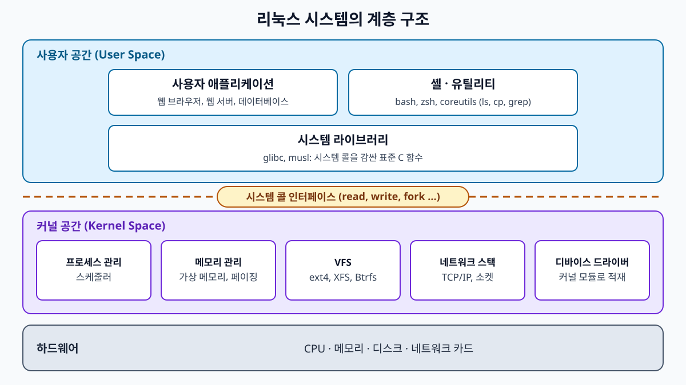
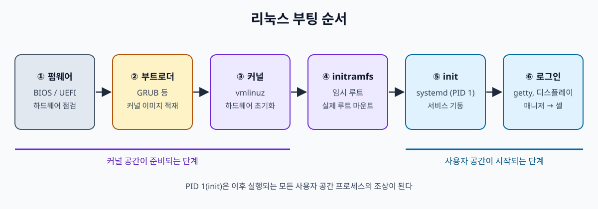
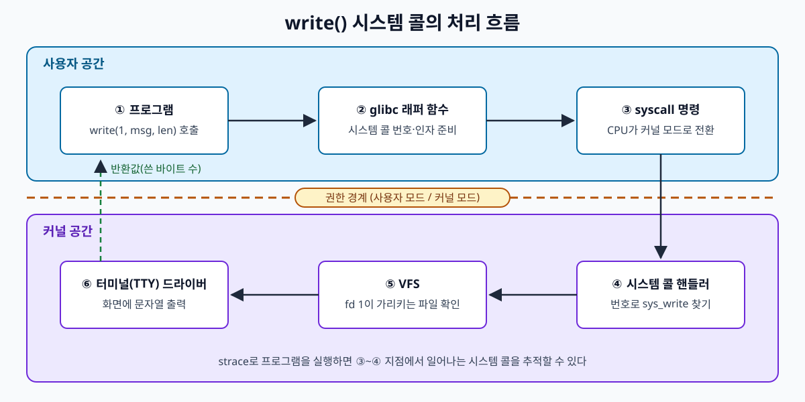

## 개요

리눅스(Linux)는 1991년 핀란드 헬싱키 대학의 학생이던 리누스 토르발스(Linus Torvalds)가 개인 프로젝트로 공개한 운영체제 **커널**에서 시작되었다. 엄밀히 말해 "리눅스"는 커널 하나만을 가리키는 이름이고, 우리가 흔히 쓰는 리눅스 운영체제는 이 커널 위에 GNU 프로젝트의 도구(셸, 컴파일러, 핵심 유틸리티, C 라이브러리 등)와 각종 소프트웨어를 묶은 결과물이다. 이런 이유로 GNU/Linux라고 부르기도 한다.

리눅스 커널은 GPLv2 라이선스로 배포되는 자유 소프트웨어이며, 유닉스(UNIX)의 설계 철학과 POSIX 표준 인터페이스를 따르는 유닉스 계열(Unix-like) 운영체제다. 오늘날 리눅스는 다음과 같은 영역에서 사실상의 표준으로 쓰인다.

- **서버·클라우드**: 웹 서버, 데이터베이스, 퍼블릭 클라우드 가상 머신의 대부분
- **컨테이너**: Docker, Kubernetes 등은 리눅스 커널의 namespace와 cgroup 기능을 기반으로 동작
- **슈퍼컴퓨터**: TOP500 목록의 시스템 전부가 리눅스 기반
- **모바일·임베디드**: 안드로이드는 리눅스 커널을 사용하며, 라우터·TV·차량용 장비 등에도 널리 탑재

이 글에서는 리눅스 운영체제를 구성하는 계층 구조와 핵심 구성 요소, 전원을 켠 뒤 셸이 뜨기까지의 부팅 순서, 그리고 같은 커널을 공유하면서도 서로 다른 모습을 가진 배포판(distribution)의 종류를 차례로 살펴본다. 리눅스 시리즈의 1편으로, 운영 명령어·리소스 모니터링·보안 같은 실제 운영 내용은 2편에서 다룬다.

## 리눅스의 계층 구조

리눅스 시스템은 크게 **하드웨어 → 커널 → 시스템 콜 인터페이스 → 사용자 공간** 순서의 계층으로 나눌 수 있다. 그림 1처럼 가장 아래의 하드웨어는 커널만 직접 다루고, 사용자 공간의 프로그램은 시스템 라이브러리와 시스템 콜 인터페이스를 거쳐서만 커널의 기능을 쓸 수 있다.


*그림 1. 리눅스 시스템의 계층 구조*

각 계층의 구성 요소와 역할을 표로 정리하면 다음과 같다.

| 계층 | 주요 구성 요소 | 역할 |
| --- | --- | --- |
| 사용자 애플리케이션 | 웹 브라우저, 웹 서버, 데이터베이스, 편집기 | 실제 작업을 수행하는 프로그램 |
| 셸·유틸리티 | bash, zsh, coreutils(ls, cp, grep 등) | 사용자와 시스템 사이의 명령 인터페이스 |
| 시스템 라이브러리 | glibc, musl | 시스템 콜을 감싼 표준 C 함수 제공 |
| 시스템 콜 인터페이스 | read, write, open, fork, execve 등 | 사용자 공간이 커널 기능을 요청하는 유일한 통로 |
| 커널 | 스케줄러, 메모리 관리, VFS, 네트워크 스택, 디바이스 드라이버 | 하드웨어 자원 관리와 추상화 |
| 하드웨어 | CPU, 메모리, 디스크, 네트워크 카드 | 물리 자원 |

### 커널 공간과 사용자 공간

CPU는 권한 수준이 다른 실행 모드를 제공하며, 리눅스는 이를 이용해 메모리와 실행 권한을 두 영역으로 분리한다.

- **커널 공간(kernel space)**: 커널 코드가 최고 권한으로 실행되는 영역. 하드웨어에 직접 접근할 수 있다.
- **사용자 공간(user space)**: 일반 프로그램이 제한된 권한으로 실행되는 영역. 하드웨어나 다른 프로세스의 메모리에 직접 접근할 수 없다.

사용자 프로그램이 파일을 읽거나 네트워크로 데이터를 보내려면 반드시 **시스템 콜(system call)**을 통해 커널에 요청해야 한다. 이 분리 덕분에 한 프로그램의 오류가 시스템 전체를 무너뜨리지 않고, 권한 없는 접근을 커널이 통제할 수 있다.

### 커널의 핵심 기능

리눅스 커널은 **모놀리식(monolithic) 커널**이다. 프로세스 관리, 메모리 관리, 파일시스템, 네트워크, 드라이버가 모두 하나의 커널 주소 공간에서 동작한다. 다만 **적재 가능한 커널 모듈(Loadable Kernel Module)**을 지원하므로, 드라이버나 파일시스템 같은 기능을 재부팅 없이 실행 중에 추가하거나 제거할 수 있다.

| 서브시스템 | 설명 |
| --- | --- |
| 프로세스 관리·스케줄러 | 프로세스와 스레드 생성·종료, CPU 시간 분배 (기본 스케줄러는 CFS를 거쳐 커널 6.6부터 EEVDF) |
| 메모리 관리 | 가상 메모리, 페이징, 스왑, 페이지 캐시 관리 |
| VFS(가상 파일시스템) | ext4, XFS, Btrfs 등 서로 다른 파일시스템을 동일한 인터페이스로 추상화 |
| 네트워크 스택 | TCP/IP 프로토콜 처리, 소켓 인터페이스, 패킷 필터링(netfilter) |
| 디바이스 드라이버 | 디스크, 네트워크 카드, USB 등 하드웨어 제어 |
| IPC | 파이프, 시그널, 공유 메모리, 소켓 등 프로세스 간 통신 |
| 격리·자원 제어 | namespace(격리)와 cgroup(자원 제한), 컨테이너 기술의 기반 |

### 셸

셸(shell)은 사용자가 입력한 명령을 해석해 프로그램을 실행하고 그 결과를 돌려주는 **명령 해석기**다. 셸 자체도 커널이 아닌 사용자 공간에서 실행되는 하나의 프로그램이다. 대표적으로 bash(대부분 배포판의 기본 셸), zsh(macOS 기본 셸이기도 함), dash(Debian 계열의 `/bin/sh`), fish 등이 있다.

### init 시스템

커널이 초기화를 마치고 가장 먼저 실행하는 사용자 공간 프로세스가 **init**이다. init은 항상 PID 1을 받으며, 이후 실행되는 모든 서비스와 프로세스의 조상이 된다. 부모가 먼저 종료된 고아 프로세스를 넘겨받아 정리하는 역할도 init이 맡는다. 현재 대부분의 주요 배포판은 **systemd**를 사용하며, Alpine처럼 경량화를 중시하는 배포판은 OpenRC 등을 사용한다. 과거에는 유닉스 System V 방식의 SysVinit이 표준처럼 쓰였다.

## 부팅 순서: 전원을 켠 뒤 셸이 뜨기까지

앞에서 본 구성 요소들은 부팅 과정에서 정해진 순서로 올라온다. 펌웨어가 부트로더를 실행하고, 부트로더가 커널을 메모리에 올리며, 커널이 준비를 마치면 init을 실행해 사용자 공간을 연다. 그림 2처럼 펌웨어부터 initramfs까지는 커널이 올라와 준비되는 과정이고, init부터는 사용자 공간이 시작되는 과정이다.

| 단계 | 구성 요소 | 하는 일 |
| --- | --- | --- |
| 1 | 펌웨어(BIOS/UEFI) | 하드웨어를 점검하고 부팅 장치에서 부트로더를 찾아 실행 |
| 2 | 부트로더(GRUB 등) | `/boot`의 커널 이미지(vmlinuz)와 initramfs를 메모리에 올리고 커널에 제어를 넘김 |
| 3 | 커널 | CPU·메모리·장치를 초기화하고 드라이버를 준비 |
| 4 | initramfs | 메모리에 풀린 임시 루트 파일시스템. 실제 루트 디스크를 여는 데 필요한 모듈을 적재하고 루트를 마운트 |
| 5 | init(systemd) | PID 1로 실행되어 네트워크, 로그, 웹 서버 같은 서비스를 순서대로 기동 |
| 6 | 로그인 | 텍스트 콘솔의 getty나 그래픽 디스플레이 매니저가 로그인을 받고 사용자 셸을 실행 |


*그림 2. 리눅스 부팅 순서*

initramfs가 따로 있는 이유는 루트 파일시스템이 RAID, LVM, 암호화 디스크처럼 별도 드라이버가 있어야 열리는 장치 위에 있을 수 있기 때문이다. 커널은 우선 메모리 안의 작은 파일시스템으로 시작해 필요한 모듈을 준비한 뒤, 실제 루트로 전환한다.

## 파일시스템 구조와 "모든 것은 파일"

리눅스는 유닉스의 "모든 것은 파일이다(Everything is a file)"라는 원칙을 따른다. 일반 문서뿐 아니라 디바이스(`/dev/sda`), 프로세스 정보(`/proc/1`), 커널 설정(`/sys`)까지 파일 형태로 노출되어, 같은 읽기·쓰기 인터페이스로 다룰 수 있다.

디렉터리 배치는 **FHS(Filesystem Hierarchy Standard)**를 따르며, 모든 경로는 하나의 루트(`/`)에서 시작하는 트리 구조다. 윈도우처럼 드라이브 문자(C:, D:)로 나뉘지 않고, 다른 디스크도 트리의 특정 위치에 **마운트(mount)**된다.

| 경로 | 용도 |
| --- | --- |
| `/bin`, `/sbin` | 기본 명령어와 시스템 관리 명령어 (최근 배포판은 `/usr/bin`으로 통합) |
| `/etc` | 시스템 전체 설정 파일 |
| `/home` | 일반 사용자의 홈 디렉터리 |
| `/root` | root 사용자의 홈 디렉터리 |
| `/var` | 로그, 캐시, 스풀 등 자주 변하는 데이터 |
| `/usr` | 사용자용 프로그램, 라이브러리, 문서 |
| `/tmp` | 임시 파일 |
| `/dev` | 디바이스 파일 |
| `/proc`, `/sys` | 커널과 프로세스 정보를 보여주는 가상 파일시스템 |
| `/boot` | 커널 이미지와 부트로더 파일 |

## 예시: 구조를 직접 확인하기

아래 명령으로 앞에서 설명한 구성 요소를 실제 시스템에서 확인할 수 있다.

### 커널과 배포판 정보 확인

```bash
# 실행 중인 커널 버전
uname -r

# 배포판 정보
cat /etc/os-release

# 현재 사용 중인 셸
echo $SHELL

# PID 1 프로세스(init 시스템) 확인
ps -p 1 -o pid,comm
```

Ubuntu 시스템에서의 출력 예시는 다음과 같다.

```text
6.8.0-45-generic

PRETTY_NAME="Ubuntu 24.04.1 LTS"
NAME="Ubuntu"
VERSION_ID="24.04"
ID=ubuntu
ID_LIKE=debian

/bin/bash

    PID COMMAND
      1 systemd
```

`ID_LIKE=debian` 항목을 통해 Ubuntu가 Debian 계열 배포판이라는 점도 확인할 수 있다.

### 커널 모듈과 가상 파일시스템

```bash
# 현재 적재된 커널 모듈 목록
lsmod | head -5

# /proc을 통해 CPU와 메모리 정보 읽기
grep "model name" /proc/cpuinfo | head -1
grep MemTotal /proc/meminfo
```

### 시스템 콜 호출 흐름

C 프로그램에서 `printf` 같은 라이브러리 함수는 결국 `write` 시스템 콜을 통해 커널에 출력을 요청한다. 다음은 `write` 시스템 콜을 직접 호출하는 예시다.

```c
#include <unistd.h>
#include <string.h>

int main(void) {
    const char *msg = "hello, kernel\n";
    /* 파일 디스크립터 1(표준 출력)에 쓰기를 커널에 요청 */
    write(1, msg, strlen(msg));
    return 0;
}
```

이 호출은 그림 3처럼 처리된다. glibc의 `write` 래퍼 함수가 시스템 콜 번호와 인자를 준비하고, `syscall` 명령으로 CPU가 커널 모드로 전환된다. 커널의 시스템 콜 핸들러는 번호로 `sys_write`를 찾아 실행하고, VFS가 파일 디스크립터 1이 가리키는 대상(여기서는 터미널)을 확인해 터미널(TTY) 드라이버로 넘긴다. 처리가 끝나면 쓴 바이트 수가 반환값으로 사용자 공간에 돌아온다.


*그림 3. write() 시스템 콜의 처리 흐름*

`strace` 명령으로 프로그램을 실행하면 이 과정에서 발생하는 시스템 콜을 추적할 수 있다.

## 리눅스 배포판의 종류

**배포판(distribution, distro)**은 리눅스 커널에 GNU 도구, 패키지 관리자, init 시스템, 데스크톱 환경, 설치 프로그램 등을 묶어 하나의 완성된 운영체제로 제공하는 것이다. 커널은 같아도 배포판마다 패키지 형식, 릴리스 주기, 기본 설정, 지원 정책이 다르다. 대부분의 배포판은 그림 4처럼 몇 개의 큰 계열로 묶을 수 있으며, 같은 계열은 패키지 형식과 패키지 관리자를 공유한다.


*그림 4. 주요 리눅스 배포판 계열*

Red Hat 계열은 업스트림과 다운스트림 관계가 뚜렷하다. Fedora에서 먼저 도입된 기술이 CentOS Stream을 거쳐 RHEL에 반영되고, Rocky Linux와 AlmaLinux는 RHEL과 호환되도록 다시 빌드한 무료 배포판이다.

### 주요 계열 비교

| 계열 | 대표 배포판 | 패키지 형식 / 관리자 | 특징 |
| --- | --- | --- | --- |
| Debian | Debian, Ubuntu, Linux Mint, Kali Linux | .deb / apt, dpkg | 방대한 패키지 저장소, 안정성 중시. Ubuntu는 데스크톱·클라우드에서 가장 널리 쓰임 |
| Red Hat | RHEL, Fedora, CentOS Stream, Rocky Linux, AlmaLinux | .rpm / dnf, rpm | 기업 서버 시장의 표준. Fedora는 신기술 도입 창구, Rocky·Alma는 RHEL 호환 무료 배포판 |
| SUSE | openSUSE Leap, openSUSE Tumbleweed, SLES | .rpm / zypper | YaST 관리 도구, 유럽 기업 환경에서 강세 |
| Arch | Arch Linux, Manjaro, EndeavourOS | .pkg.tar.zst / pacman | 롤링 릴리스, 최소 구성에서 사용자가 직접 조립. AUR 커뮤니티 저장소 |
| 독립 계열 | Alpine Linux | .apk / apk | musl libc와 BusyBox 기반, 기본 이미지가 수 MB 수준으로 작아 컨테이너 베이스 이미지로 인기 |
| 독립 계열 | Gentoo | 소스 기반 / Portage(emerge) | 소스 코드를 직접 컴파일해 시스템에 최적화 |

### 계열별 패키지 설치 명령

같은 작업이라도 계열마다 패키지 관리자 명령이 다르다. 다음은 `curl`을 설치하는 예시다.

```bash
# Debian / Ubuntu
sudo apt update && sudo apt install curl

# RHEL / Fedora / Rocky / AlmaLinux
sudo dnf install curl

# openSUSE / SLES
sudo zypper install curl

# Arch / Manjaro
sudo pacman -S curl

# Alpine
sudo apk add curl
```

### 릴리스 모델: 고정 릴리스와 롤링 릴리스

배포판은 업데이트 방식에 따라 두 가지로 나뉜다.

| 구분 | 방식 | 예시 | 장단점 |
| --- | --- | --- | --- |
| 고정 릴리스(Point Release) | 일정 주기로 버전을 내고, 해당 버전 안에서는 보안·버그 수정 위주로 업데이트 | Debian, Ubuntu LTS, RHEL, openSUSE Leap | 안정적이고 예측 가능하지만 최신 소프트웨어 반영이 느림 |
| 롤링 릴리스(Rolling Release) | 버전 구분 없이 패키지를 계속 최신으로 갱신 | Arch Linux, openSUSE Tumbleweed, Gentoo | 항상 최신 소프트웨어를 쓸 수 있지만 업데이트로 인한 호환성 문제 가능성이 상대적으로 큼 |

서버 환경에서는 장기 지원(LTS)을 제공하는 고정 릴리스 배포판을, 개발용 데스크톱이나 최신 하드웨어 지원이 필요한 환경에서는 롤링 릴리스나 Fedora 같은 빠른 주기의 배포판을 선택하는 경우가 많다.

### 용도별 일반적인 선택

| 용도 | 많이 쓰이는 배포판 |
| --- | --- |
| 입문용 데스크톱 | Ubuntu, Linux Mint, Fedora Workstation |
| 기업 서버 | RHEL, Rocky Linux, AlmaLinux, Ubuntu Server, SLES |
| 클라우드·컨테이너 | Ubuntu, Debian, Alpine, Amazon Linux |
| 보안·모의해킹 | Kali Linux, Parrot OS |
| 학습·커스터마이징 | Arch Linux, Gentoo |

## 정리

- 리눅스는 1991년 리누스 토르발스가 공개한 GPLv2 기반의 유닉스 계열 **커널**이며, 여기에 GNU 도구와 각종 소프트웨어를 결합한 것이 리눅스 운영체제다.
- 시스템은 **하드웨어 → 커널 → 시스템 콜 인터페이스 → 라이브러리 → 셸·애플리케이션**의 계층으로 구성되고, 커널 공간과 사용자 공간이 분리되어 있다.
- 커널은 모듈 적재를 지원하는 **모놀리식 커널**로, 프로세스·메모리·파일시스템·네트워크·드라이버를 관리한다.
- 부팅은 **펌웨어 → 부트로더 → 커널 → initramfs → init(PID 1) → 로그인** 순서로 진행되며, init부터 사용자 공간이 시작된다.
- **"모든 것은 파일"** 원칙에 따라 디바이스와 커널 정보까지 파일로 다루며, 디렉터리는 FHS에 따라 `/` 하나에서 시작하는 트리 구조다.
- **배포판**은 커널에 패키지 관리자, init 시스템, 기본 소프트웨어를 묶은 완성형 운영체제로, Debian·Red Hat·SUSE·Arch 계열과 Alpine·Gentoo 같은 독립 계열로 나뉜다. 패키지 형식, 릴리스 모델, 지원 정책을 기준으로 용도에 맞는 배포판을 선택한다.

다음 편에서는 이 구조 위에서 시스템을 실제로 운영하는 방법, 즉 운영 명령어와 리소스 모니터링, 보안 설정을 다룬다.
