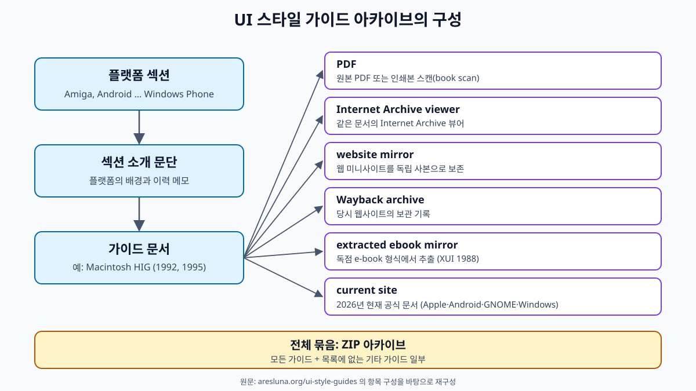

## 개요

UI 스타일 가이드(interface guidelines)는 운영체제나 플랫폼을 만든 회사가 "이 플랫폼에서는 창, 메뉴, 버튼, 대화상자를 이렇게 만들어라"라고 정리해 개발자와 디자이너에게 배포한 문서다. Apple의 Human Interface Guidelines(HIG), Google의 Material Design, Microsoft의 Windows 가이드라인이 대표적이다.

2026년 11월, Marcin Wichary가 자신의 사이트 Aresluna에 **"UI style guides"** 페이지를 공개했다. 페이지는 스스로를 "1980년대 초부터 오늘날까지 여러 회사의 UI 스타일 가이드를 보존한 모음"이라고 소개하며, 머리말 기준으로 **86종**의 가이드를 수록하고 있다(2026년 11월 25일 게시, 26일 갱신). 국내에서는 GeekNews를 통해 소개되었다.

```link
url: https://aresluna.org/ui-style-guides/
```

이 글에서는 이 아카이브가 어떻게 구성되어 있는지, 어떤 시대와 플랫폼을 다루는지, 대표적인 가이드가 어떤 계보로 이어지는지, 그리고 자료를 어떤 방식으로 보존했는지를 차례로 살펴본다.

## 아카이브의 구성

작성자에 따르면 상당수 PDF는 이미 인터넷에 돌아다니던 것이지만, 이를 한곳에 모으고 주제와 시대별로 묶은 뒤 중요한 것을 강조했다. 일부는 찾기 어려운 자료였고, 몇몇은 작성자가 직접 스캔했으며, 여러 미니사이트는 독립된 미러(사본)로 만들어 두었다.

페이지는 플랫폼별 섹션으로 나뉜다. 각 섹션은 그 플랫폼이 무엇이었는지 설명하는 짧은 소개 문단으로 시작하고, 그 아래에 가이드 문서가 연도·판본별로 나열된다. 하나의 가이드는 다시 여러 형식의 링크로 제공된다. 그림 1처럼 "섹션 → 소개 문단 → 가이드 문서 → 판본·형식 링크"의 구조이고, 전체를 한 번에 받을 수 있는 ZIP 아카이브가 따로 있다.


*그림 1. 아카이브 한 항목의 구성과 제공 형식*

제공 형식은 다음과 같다.

| 형식 | 내용 | 예 |
| --- | --- | --- |
| PDF | 원본 PDF, 또는 인쇄본을 스캔한 book scan | Macintosh HIG 1992 book scan |
| Internet Archive viewer | Internet Archive에 올린 같은 문서의 뷰어 링크 | 대부분의 PDF 항목에 함께 제공 |
| website mirror | 웹 미니사이트로만 존재하던 가이드를 독립 사본으로 보존 | Android Design 2012, Material Design v1·v2 |
| Wayback archive | 당시 웹사이트의 Wayback Machine 보관 기록 | Glass Developers: Design 2013 |
| extracted ebook mirror | 독점 e-book 형식에서 역공학으로 추출한 사본 | DECwindows XUI Style Guide 1988 |
| current site | 2026년 현재 공식 문서로 연결 | Apple HIG, Design for Android, GNOME HIG, Design basics for Windows apps |

일부 미러에는 가벼운 정리 작업이 들어갔다. 원문은 그 예로 이미지를 더 선명한 픽셀로 처리하기, 링크로만 걸려 있던 이미지를 본문에 넣기, 유튜브 임베드 고치기를 든다. 같은 가이드의 초안(draft)·사전 공개본(preliminary, pre-release)·개정판이 함께 실린 경우도 많다. 예를 들어 1986~1987년 Apple의 Human Interface Guidelines는 두 번째 베타 초안, 최종 초안, 2쇄, 4쇄가 각각 따로 올라와 있다.

## 시대와 플랫폼별 수록 범위

수록 범위는 Apple, Microsoft, Google 같은 현재의 주요 플랫폼에 그치지 않는다. 이미 사라졌거나 실패한 플랫폼의 가이드도 함께 다룬다. 그림 2는 원문 목록의 연도를 기준으로 시대별 대표 항목을 골라 배치한 것이다.

![1980년대부터 2020년대까지 10년 단위 다섯 칸으로 나눈 UI 스타일 가이드 연표. 1980년대에는 Apple Lisa, Apple IIe, Windows SDK, Apple Desktop HIG, DECwindows XUI, OPEN LOOK, 1990년대에는 NeXTstep, Amiga, CUA, Motif, PenPoint, Macintosh HIG, SGI, Taligent, Newton, CDE, Java, BeOS, 2000년대에는 Aqua, Windows XP, GNOME, BlackBerry, Palm OS, Nokia, Office, Windows Mobile, iPhone, Surface, 2010년대에는 iPad, Windows Phone 7, webOS, Android, iOS 7, Glass, Kinect, Material Design, Windows 10, Cardboard, One UI, 2020년대에는 KDE, Samsung Smart TV, RISC OS, 현재 공식 사이트가 적혀 있다](./assets/ui-style-guides-archive-timeline.svg)
*그림 2. 시대별 대표 가이드 (원문 목록에서 일부를 골라 재구성)*

원문의 섹션을 성격별로 묶으면 다음과 같다.

| 분류 | 원문 섹션 |
| --- | --- |
| 현재도 이어지는 주요 플랫폼 | Macintosh, Mac(Aqua 이후), iOS·iPadOS, Windows, Android, GNOME, KDE |
| 1980~1990년대 데스크톱·워크스테이션 | Amiga, GEM/TOS, NeXTSTEP, CUA, CDE(OSF/Motif), OPEN LOOK, DECwindows XUI, Silicon Graphics, Taligent, RISC OS, BeOS |
| 초기 모바일·PDA·태블릿 | Newton, PenPoint, Magic Cap, Palm OS, webOS, BlackBerry, Nokia(Symbian 포함), Sony Ericsson, Windows Phone, Samsung |
| 새로운 입력 장치·형태 | Kinect, Surface(현 PixelSense), Google VR/AR(Glass, Cardboard) |
| 기타 | Java(Look and Feel), Microsoft Office(리본) |

각 섹션의 소개 문단에는 그 플랫폼의 짧은 이력이 적혀 있다. 원문은 Newton을 "1993년에 출시되어 1998년에 버려진 Apple의 PDA"로, PenPoint를 "GO Corporation이 실패한 기기 라인을 위해 만든 초기 태블릿 운영체제"로, Magic Cap을 "General Magic의 버려진 모바일 OS"로 소개한다. BeOS는 제대로 된 HIG가 "수많은 약속에도 끝내 나오지 않았고", 실린 문서는 BeOS R4.5 CD에서 추출한 "예비적이고 불완전한" 가이드라인이라고 밝힌다. Android 섹션에는 작성자가 찾을 수 있었던 첫 스타일 가이드가 2012년 것이라고 적혀 있다.

## 주요 플랫폼의 가이드 계보

판본이 가장 촘촘하게 남아 있는 것은 Apple과 Microsoft의 가이드다. 그림 3은 두 회사의 가이드를 원문 목록의 연도대로 이은 것이다.


*그림 3. Apple과 Microsoft 가이드의 계보 (원문 목록의 연도 기준)*

**Apple(Mac)** 은 1980년 Lisa의 "Lisa UI Standards"에서 시작한다. 원문은 이를 Lisa부터 고전 Mac OS까지 이어지는 역사적 Apple GUI 가이드로 묶고, 중간에 Apple II 가이드(1982 Apple IIe Design Guidelines, 1985 Apple II HIG 사전 공개본)를 함께 싣는다. 이후 1986~1987년 Apple Desktop Interface HIG, 1992·1995년 Macintosh HIG, 1996·1997년 Mac OS 8 HIG로 이어진다. Mac OS X 시기에는 2000년 "Adopting the Aqua Interface"와 2001~2002년 Aqua HIG가 나오고, 2004년부터 2009년까지는 "변화하는 Aqua"를 다루는 Apple HIG가 거의 해마다 개정되었다. 2012~2014년의 OS X Interface Guidelines는 원문 표현으로 "순수한 Aqua와 Liquid Glass 사이의 시대"를 다룬다.

**Apple(iOS)** 은 2008년 iPhone HIG에서 시작한다. 원문은 iOS 1~6의 스큐어모피즘 시대를 다룬 iPhone HIG 판본(2008~2011년)과 iOS 7 이후를 다룬 iOS HIG(2013·2014년)를 나누어 싣고, 2010년 iPad HIG를 따로 둔다. Mac과 iOS 계보는 모두 현재의 Apple Human Interface Guidelines 공식 사이트로 연결된다.

**Microsoft(Windows)** 는 1986년 Windows SDK Application Style Guide 1.03에서 시작해 1992년 "The Windows Interface: An Application Design Guide", 1995년 "The Windows Interface Guidelines for Software Design", 1999~2001년 User Experience 공식 가이드라인, 2001년 Windows XP Visual Guidelines, 2010년 Windows 7·Vista용 UX Interaction Guidelines, 2012년 Windows 8과 2015년 Windows 10(UWP) 가이드라인을 거쳐 현재의 "Design basics for Windows apps"로 이어진다. 원문은 1990년 전후에 작은 공백이 있는데, 이 시기 Microsoft가 IBM과 협력한 CUA(Common User Access) 프레임워크에 몰두했기 때문이라고 설명한다. CUA 섹션은 CUA를 "Windows와 OS/2에 영향을 준 1980년대 후반의 사용자 인터페이스 표준"으로 소개한다.

**Google(Android)** 는 2012년 Android Design, 2015년 Material Design v1, 2018년 Material Design v2를 웹사이트 미러와 Wayback 기록으로 보존하고, 현재의 Design for Android 사이트로 연결한다. 모바일 쪽에서는 Nokia 섹션의 분량도 많은데, 1999년 Nokia 9110 Communicator부터 Series 40·60·80·90, Hildon, Symbian(UIQ, Symbian^3, Belle), 2011년 Nokia N9 UX Guidelines까지 실려 있다.

## 보존과 복원 방식

이 아카이브의 상당 부분은 원래 형태 그대로는 지금 읽기 어려운 자료다. 원문에 드러난 보존 방식은 다음과 같다.

- **스캔**: Macintosh HIG(1992), NeXTSTEP UI Guidelines(1993), Java Look and Feel Design Guidelines(1999), The Windows Interface Guidelines for Software Design(1995) 등은 인쇄본을 스캔한 book scan PDF로 제공된다.
- **웹사이트 미러**: 웹으로만 공개되었다가 사라진 가이드(Android Design 2012, Material Design v1·v2, Glass, Cardboard, Windows XP Visual Guidelines 등)는 독립된 사본으로 만들고 Wayback 기록도 함께 링크한다.
- **역공학**: DECwindows XUI Style Guide(1988)는 원문 표현으로 "독점 e-book 형식에서 역공학으로 복원"했다.
- **현재 문서 연결**: Apple, Android, GNOME, Windows는 2026년 현재 공식 사이트로 이어지는 링크를 함께 둔다.

페이지 하단에는 생성형 AI 사용에 대한 명시가 있다. 원문은 이 페이지를 쓰고 디자인하고 큐레이션하는 데 생성형 AI를 쓰지 않았고, 스타일 가이드 파일을 변환하거나 잘 알려지지 않은 독점 형식을 역공학해 가이드를 복구하는 단순 작업에만 일부 AI 기술을 썼다고 밝힌다. 또 이 모음이 Chris Silverman, Geof Crowl, Matt Sephton, Matthias Rauterberg, Přemysl Eric Janouch 등 다른 사람들의 컬렉션에 힘입었다고 적고, 빠진 가이드가 있으면 알려 달라고 요청한다. 전체 ZIP에는 페이지에 나열되지 않은 기타 가이드도 몇 개 들어 있다.

## 커뮤니티 반응

GeekNews 소개글에는 Hacker News 토론을 요약한 댓글과 국내 사용자 댓글이 달렸다. 주요 반응은 다음과 같다.

- **오래된 가이드의 내용 자체에 대한 관심**: 1991년 Amiga 가이드의 첫 페이지가 성 중립적 대명사 문제를 다루고, 예시에서 성별을 무작위로 번갈아 썼다는 점이 화제가 되었다.
- **옛 GUI에 대한 향수와 변화의 원인 분석**: 회색·은색 UI 시절에는 상호작용하는 요소와 정적인 요소를 구분하기 쉬웠다는 의견, 반응형 디자인으로 픽셀 기반 레이아웃이 중첩된 레이아웃 매니저로 바뀐 것이 전환점이었다는 의견이 나왔다. 2000년대 초 Windows UX 가이드라인이 외형보다 기능과 사용성에 집중했다는 평가도 있었다.
- **추가 요청**: IBM Carbon 디자인 시스템, KDE2 스타일 가이드 등을 넣어 달라는 요청이 있었다. Windows 7·Vista 가이드가 빠졌다는 지적도 있었는데, 현재 원문 목록에는 2010년 "User Experience Interaction Guidelines for Windows 7 and Windows Vista"가 실려 있다.
- **실사용 경험**: NeXTSTEP 문서를 다시 보니 반갑다는 국내 댓글, PenPoint 자료를 받아 본 경험담, BeOS UI를 재현하는 데 이 자료가 유용하다는 의견이 있었다.

## 정리

| 항목 | 내용 |
| --- | --- |
| 작성자 | Marcin Wichary (Aresluna) |
| 공개 | 2026년 11월 25일 게시, 26일 갱신 |
| 수록 | 86종 (원문 머리말 기준), 1980년 Lisa UI Standards부터 2026년 현재 공식 문서까지 |
| 범위 | Apple·Microsoft·Google 등 현행 플랫폼과 Amiga, NeXTSTEP, Newton, PenPoint, BeOS, webOS 등 사라진 플랫폼, Kinect·Surface·Glass 같은 새 입력 장치 |
| 형식 | PDF, book scan, Internet Archive viewer, website mirror, Wayback archive, 추출한 e-book, 현재 공식 사이트, 전체 ZIP |
| 보존 작업 | 직접 스캔, 미니사이트 미러링, 이미지·임베드 정리, 독점 형식 역공학 |

이 아카이브는 각 시대 플랫폼 회사가 스스로 정한 인터페이스 원칙을 원래 문서 그대로 나란히 놓고 볼 수 있게 해 준다. 같은 회사의 가이드가 판본별로 이어져 있어 한 플랫폼의 인터페이스 원칙이 어떻게 바뀌었는지 추적할 수 있고, 같은 시기 서로 다른 회사의 가이드를 비교할 수도 있다.
